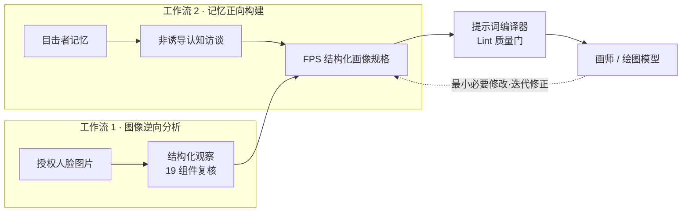

<h1 align="center">刑事摹拟画像 Skill</h1>

<p align="center">
  <strong>Forensic Facial Composite Skill</strong><br>
  可追溯、可校验的刑侦级人脸描述与摹拟画像提示词工程框架
</p>

<p align="center">
  <a href="./LICENSE"></a>
  <a href="English/forensic-facial-composite/SKILL.md"></a>
  <a href="English/scripts"></a>
  <a href="English/knowledge/source_manifest.yaml"></a>
  <a href="English/README.md"></a>
  <a href="https://github.com/doubsumi/criminal-simulated-portraiture-skill/stargazers"></a>
</p>

> **定位声明**：本项目是研究性工具，不是身份识别系统，也不是经过认证的司法鉴定方法。生成图像的相似度未经系统验证，判断权留给使用者。

---

## 概览

本 Skill 将"如何系统性地产出可信的人脸描述"作为核心问题，把法证面部形态学观察、中国公共安全行业标准的流程与编码锚点、非诱导认知访谈与跨模型提示词编译，整合为两条共用同一中间表示（FPS · 结构化画像规格）的可执行工作流：



## 核心特性

- **双工作流架构**：图像逆向分析（Image-to-Description）与记忆正向构建（Memory-to-Portrait）共享 FPS 作为唯一中间表示。
- **受控词汇与结构化编码**：特征描述对齐 GA 240.24 受控词汇，输出具备与公安信息交换体系兼容的潜力。
- **19 组件覆盖复核**：以 FISWG 组件清单为逐项检查框架，每个观察维度携带受控 `dimension_id`，防止特征合并。
- **来源可追溯**：每项特征观察携带来源与置信度标注；[公开来源清单](English/knowledge/source_manifest.yaml)记录出版方链接、版本与权利状态。
- **提示词质量门**：`prompt_lint` 在生图前对指令泄漏、长度、模糊限定词与身份锚点缺失打分。
- **诚实的边界**：不承诺纯文本路径下的固定人脸相似度百分比；"无依据编造率 0%" 为红线指标。

## 专业标准锚点

| 来源 | 类型 | 支持什么 | 不支持什么 |
| --- | --- | --- | --- |
| GA/T 601—2006 | 行业标准（流程规则） | 摹拟画像的制作目的、适用对象、规程定位 | 面部特征分类与词表 |
| GA 240.24—2003 | 行业标准（信息代码） | 受控类型取值、矩阵式编码逻辑 | 人脸形态"正确性"规范 |
| FISWG Feature List | 专业工作组指南 | 19 组件覆盖清单、观察维度 | 比较流程本身、分类系统 |

## 快速开始

脚本仅负责校验与编译，不读取图像像素、不调用生图服务；画像 Profile 由具备视觉能力的主机按[图像观察协议](English/docs/image-observation-protocol.md)产出。

```bash
cd English

# Schema 校验
python scripts/validate_schemas.py

# 图像描述生成与审查（需已完成的审查与授权）
python scripts/image_description.py PATH_TO_PROFILE --vision-attested --image-authorized

# 提示词编译
python scripts/prompt_compiler.py PATH_TO_PROFILE --vision-attested --image-authorized --format text

# 提示词质量评分
python scripts/prompt_lint.py PATH_TO_PROFILE
```

## 目录结构

```
.
├── Chinese/                  # 中文设计文档（开发规格说明书）
└── English/                  # Skill 主工程
    ├── docs/                 # 公开协议、文档索引、变更日志
    ├── knowledge/            # 本体、规则、术语、公开来源元数据
    ├── schemas/              # 8 个 JSON Schema 数据契约
    ├── examples/             # 合成结构化示例（不含真实照片）
    ├── scripts/              # 校验、编译、lint 本地工具
    └── forensic-facial-composite/  # Agent Skills 入口
```

## 当前状态

| 已交付 | 规划中 |
| --- | --- |
| 19 组件面部本体 | 记忆访谈工作流 |
| 图像观察规则 | 完整模型适配工作流 |
| 8 个 JSON Schema 与示例画像 | 生成图像相似度的系统化验证 |
| 图像描述审查器与提示词编译器 / lint | |

## 愿景

"Agent Skill 形态的通用人像 Prompt 生成器已存在，但**刑事摹拟画像专业流程 + 非诱导访谈 + 可追溯结构化描述**的交集尚属空白"——本项目定位于填补这一空白：

1. **专业深度**：以国内公共安全行业标准和 FISWG 组件清单为骨架，让输出贴近刑侦实务。
2. **可追溯**：每项特征观察携带来源与受控维度标识，描述可校验、可比对、可复盘。
3. **人机协同的正确边界**：人锁定核心刑侦特征，AI 负责结构化与渲染；迭代修正遵循"最小必要修改、局部修复优先"，而非整段重写。
4. **诚实优先**：如实记录每次生成与评价，把相似度判断权留给使用者，不夸大能力边界。

## 许可证

本项目自产代码与内容以 **[GNU LGPL-3.0](./LICENSE)** 发布；[COPYING](./COPYING) 为 LGPL-3.0 所引用的 GPL-3.0 正文。

第三方标准与论文仍受其出版方条款约束，公开下载链接不等于再分发授权；请勿将本项目的翻译或摘要视为出版方认可的标准文本。

## English

English documentation: **[English/README.md](English/README.md)**
